  

  

  
  
  
  
  
  
  

  

**🇧🇷** Da investigação forense ao desenvolvimento de soluções de defesa: minha trajetória é pautada por **antecipar ameaças antes que elas virem incidentes**. Comecei liderando investigações de intrusão, recuperação pós-ransomware e resposta a vazamentos de dados. Levei essa bagagem para a engenharia de software, automatizando detecção de ameaças com Python e AWS. Hoje, como **CEO da [Request.Coffee](https://request.coffee)**, uno a mentalidade ofensiva do Ethical Hacking ao rigor da Engenharia de Software para entregar resiliência cibernética de verdade.

**🇺🇸** From digital forensics to building defensive solutions: my work is about **anticipating threats before they become incidents**. I started out leading intrusion investigations, ransomware recovery and data-breach response, then brought that mindset into software engineering, automating threat detection with Python and AWS. Today, as **CEO of [Request.Coffee](https://request.coffee)**, I combine an offensive Ethical Hacking mindset with solid software engineering to deliver real cyber resilience.

**Segurança digital sem atalhos.** Hub brasileiro de cibersegurança, Top 5 em Cibersegurança no Brasil segundo a The Manifest.

| 🧪 Request Labs | 🛡️ Consultoria | 🎤 Comunidade |
| :-- | :-- | :-- |
| Laboratórios CTF com cenários reais para treinar ataque e defesa. Plataforma própria e patenteada. | Pentest, SOC e DevSecOps com equipe sênior e atendimento em todo o Brasil. | Imersões práticas e eventos para técnicos e lideranças: SENAI, C-Levels, Mulheres em Tech. |

  
  

| Quando | Função | Onde | Destaques |
| :-- | :-- | :-- | :-- |
| 2025 → hoje | **CEO & Founder** | Request.Coffee | Fundou a empresa do zero. Programas de treinamento em Ethical Hacking, Pentest e Defensive Coding; software seguro sob medida para clientes. |
| 2024 | **Investigative Analyst** | LIT — Inteligência e Tecnologia | Investigações de inteligência digital e identificação de ameaças, com fluxos de análise orientados por tecnologia. |
| 2022 – 2024 | **Software Engineer** | Ventura ERM | Automação de detecção de comportamento malicioso (Python/RegEx) e sistema de alertas em tempo real com AWS CloudTrail. |
| 2021 – 2024 | **Digital Forensics Analyst** | Ventura ERM | Recuperação em ataques de ransomware de alta criticidade e recuperação de dados exfiltrados como evidência judicial (IPED, Magnet AXIOM). |

| Projeto | O que é | Stack |
| :-- | :-- | :-- |
| 🌐 [**Portfólio**](https://renan-pontes.github.io) | Meu portfólio bilíngue: segurança, OSINT, IA e full-stack | HTML · CSS · JS |
| 🐉 [**Forja de Heróis**](https://github.com/Renan-Pontes/RPG-D-D-5e-fichas-Easy) · [demo](https://rpg-d-d-5e-fichas-easy.vercel.app) | Fichas de D&D 5e com campanhas, painel do mestre e telão de TV | React · Three.js · Django |
| 🎮 [**Sábado Games**](https://github.com/Renan-Pontes/SabadoGamesForUS) · [demo](https://sabadogames.app) | Party games para jogar com a galera, até 15 pessoas com a TV de telão | React · TypeScript · Django · PostgreSQL |
| 🎨 [**SpriteSheet Creator with AI**](https://github.com/Renan-Pontes/SpriteSheetCreator_WithAI) | Gera e monta sprite sheets para jogos com IA generativa | Python · PyTorch · Diffusers |
| 🃏 [**MTG Deck Builder**](https://github.com/Renan-Pontes/MTG-DeckBuilder) | Construtor de decks de Magic com detecção de combos e curva de mana | Node.js · Express · Scryfall API |
| 🎲 [**FATE Forge**](https://github.com/Renan-Pontes/RPG-FATE-FICHAEREGISTRO) | Mesa do mestre para FATE Acelerado com atributos ocultos | React · Django |
| 💊 [**CRUZ**](https://github.com/Renan-Pontes/CRUZ) | Plataforma de farmácia criada no Hackathon da Cruzeiro do Sul | React · TypeScript · Django |
| ⛪ [**SITE-IASD**](https://github.com/Renan-Pontes/SITE-IASD) | Gestão de programação de igreja, open source | React · Tailwind · Django |

> 🔒 Boa parte do meu trabalho em segurança é privado: plataforma de inteligência OSINT, motor de grafos para investigação, detecção de fraude interna e a Request Cup, arena de CTF ao vivo. Os detalhes estão no [portfólio](https://renan-pontes.github.io).

   
   
  

  
  
  
  
  
  
  
  

- 🟣 Gestão de vulnerabilidades e visibilidade de ativos: *ninguém protege o que não sabe que tem*
- 🟣 Risco cibernético como decisão de negócio, não só da TI
- 🟣 Segurança em engenharia de dados, pipelines e IA
- 🟣 Cultura de segurança, gestão de acessos e ameaças internas

→ [Acompanhe no LinkedIn](https://www.linkedin.com/in/repontes/)

  <picture>
    <source media="(prefers-color-scheme: dark)" srcset="https://streak-stats.demolab.com?user=Renan-Pontes&hide_border=true&border_radius=12&background=160B2E&stroke=4C1D95&ring=A78BFA&fire=C4B5FD&currStreakNum=FFFFFF&sideNums=FFFFFF&currStreakLabel=C4B5FD&sideLabels=E9D5FF&dates=A78BFA" />
    
  </picture>

  <picture>
    <source media="(prefers-color-scheme: dark)" srcset="https://raw.githubusercontent.com/Renan-Pontes/Renan-Pontes/output/snake-purple-dark.svg" />
    
  </picture>

  🤿 Mergulho · 🎸 Violão · 🐉 RPG de mesa (D&D 5e e FATE) · 🃏 Magic: The Gathering · 🎭 Cosplay · ✈️ Viagens · 🐶 Pets

<i>"Onde há uma vontade forte, não pode haver grandes dificuldades."</i>

  

